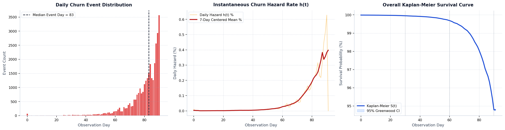
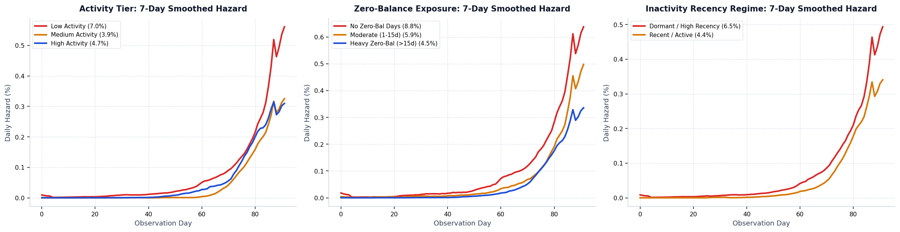
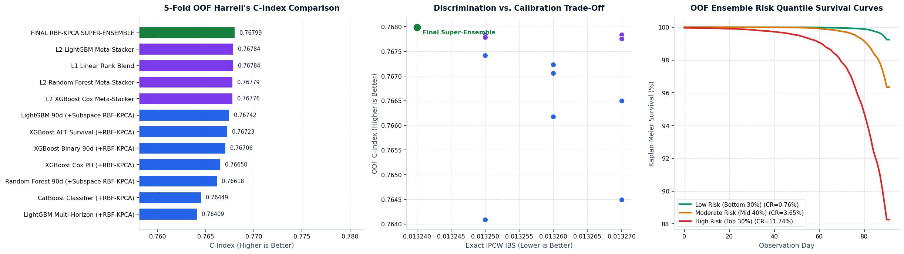
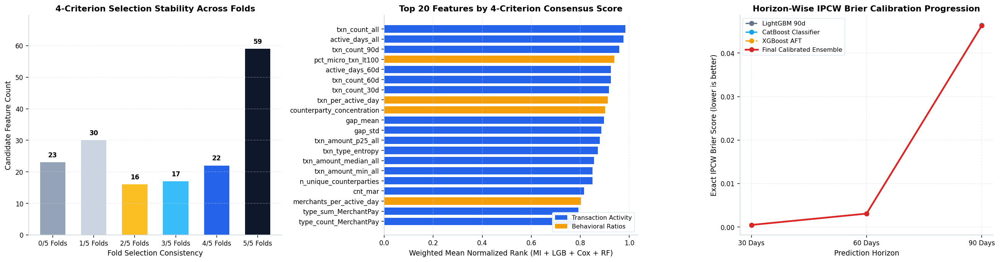
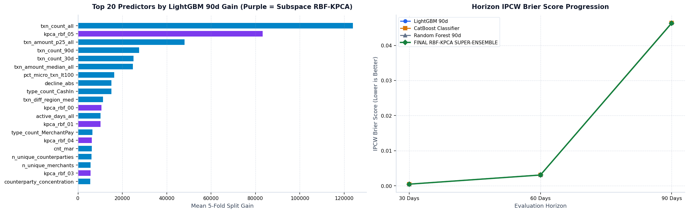
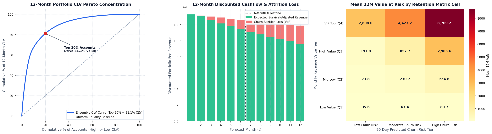
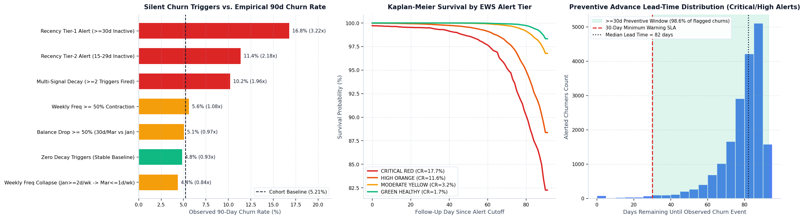

# Empirical Survival Analysis, Customer Lifetime Value (CLV), and Silent-Churn Early Warning — Benchmark & Results Summary

This `README.md` compiles the **verified empirical results, ablation tables, financial valuation outcomes, and preventive backtest diagnostics** generated directly from the four executed notebooks in this repository across **`850,000` retail mobile financial services (MFS) accounts** (`595,000` labeled training accounts observed over a `91-day` follow-up window; `255,000` unlabeled holdout accounts; reference snapshot `2024-03-31`).

---

## Repository Results Index (4 Executed Experiments)

| Experiment Notebook | Feature Space | 5-Fold OOF C-Index | Mean Brier (`30/60/90d`) | Exact IPCW IBS | 5-Fold Train Time | Primary Output Focus |
| :--- | :---: | :---: | :---: | :---: | :---: | :--- |
| [Unpruned Behavioral Features.ipynb](./Unpruned%20Behavioral%20Features.ipynb) | `167D` (`161` + `6` OOF TE) | `0.76769` | `0.01663` | `0.01324` | `93.80 min` (`5,627.9s`) | Full-dimensional baseline benchmark |
| [4-Criterion Non-Linear Feature Selection.ipynb](./4-Criterion%20Non-Linear%20Feature%20Selection.ipynb) | `95–115D/fold` (`98` consensus) | `0.76780` | **`0.01662`** | `0.01324` | **`62.21 min`** (`-33.7%`) | Shadow-gated feature pruning & Pareto speedup |
| [Subspace RBF Kernel PCA.ipynb](./Subspace%20RBF%20Kernel%20PCA.ipynb) | **`175D`** (`167` + `8D` KPCA) | **`0.76799`** | `0.01663` | **`0.01324`** | `101.43 min` (`6,085.6s`) | Peak survival ensemble + 12M CLV/VaR matrix |
| [Early Warning System (EWS) for Silent Churn.ipynb](./Early%20Warning%20System%20%28EWS%29%20for%20Silent%20Churn.ipynb) | **`178D`** (`170` + `8D` KPCA) | `0.76798` | `0.01663` | `0.01324` | `100.77 min` (`6,045.9s`) | Silent-churn velocity decay triggers & 30d EWS SLA |

---

## 1. Cohort Hazard Profiling & Behavioral Survival Stratification (`N = 595,000`)

Across the `595,000` labeled accounts, **`30,994` confirmed churn events (`5.21%`)** and **`564,006` right-censored accounts (`94.79%`)** are observed over `91` days. Risk accelerates sharply in the final third of the quarter (`101.3×` daily hazard surge from Days `0–30` to Days `61–91`).

### 1.1 Discrete Horizon Concentration & Cohort Timing Summary

| Observation Horizon | Churn Events | Share of Total Churns (%) | Mean Daily Hazard (%) | Period-End KM Survival (%) | Timing Quantiles / Peak |
| :--- | :---: | :---: | :---: | :---: | :--- |
| **Early Horizon (`0–30d`)** | `286` | `0.92%` | `0.0016%` | `99.95%` | Min Day = `0`, `P25` = `76` |
| **Mid Horizon (`31–60d`)** | `1,593` | `5.14%` | `0.0089%` | `99.68%` | Median = `83`, Mean = `79.98` |
| **Late Horizon (`61–91d`)** | **`29,115`** | **`93.94%`** | **`0.1621%`** | **`94.79%`** | `P75` = `88`, Peak = `Day 90` (`3,565` events, `0.6281%`) |

### 1.2 Demographic, Tenure & Behavioral Hazard Findings

* **Tenure Separation (Log-Rank `@1,434d` split):** Statistically significant separation across median tenure (`297,973` newer vs. `297,027` older; $\chi^2 = 4.77$, $p = 2.891 \times 10^{-2}$). `Growing (91-365d)` wallets churn at **`6.55%`** (`0.725` hazard / 1k days) vs. `Established (1-3y)` at **`5.43%`** and `Veteran (>3y)` at **`5.17%`**.
* **Narrow Demographic Spread:** Regional churn spans `5.03%` (`Rangpur`) to `5.28%` (`Dhaka`); gender rates stay tightly bounded (`Female 5.26%`, `Male 5.18%`, `Other 5.13%`).
* **U-Shaped Activity & Zero-Balance Liquidity Paradox:** `Low Activity` wallets churn at **`7.01%`** vs. `Medium Activity` **`3.92%`** and `High Activity` **`4.70%`**. Counterintuitively, static wallets with `No Zero-Bal Days` churn at **`8.803%`** (`91.197%` KM survival)—nearly double `Heavy Zero-Bal (>15d)` accounts (**`4.451%`**)—because active spenders regularly drain and refund wallets whereas stale funded wallets become dormant.

| Behavioral Dimension | Segment Tier | Accounts | Churn Events | Churn Rate (%) | Hazard / 1k Person-Days | KM 90d Survival (%) |
| :--- | :--- | :---: | :---: | :---: | :---: | :---: |
| **Activity Terciles** | `Low Activity` | `198,333` | `13,902` | **`7.009%`** | `0.778` | `92.991%` |
| | `Medium Activity` | `198,333` | `7,778` | **`3.922%`** | `0.432` | `96.078%` |
| | `High Activity` | `198,334` | `9,314` | `4.696%` | `0.519` | `95.304%` |
| **Zero-Balance Exposure** | `No Zero-Bal Days` | `72,500` | `6,382` | **`8.803%`** | **`0.981`** | **`91.197%`** |
| | `Moderate (1-15d)` | `96,464` | `5,650` | `5.857%` | `0.648` | `94.143%` |
| | `Heavy Zero-Bal (>15d)` | `426,036` | `18,962` | `4.451%` | `0.491` | `95.549%` |
| **Recency Stratification** | `Dormant / High Recency` | `224,064` | `14,530` | **`6.485%`** | `0.719` | `93.515%` |
| | `Recent / Active` | `370,936` | `16,464` | `4.439%` | `0.490` | `95.561%` |

---

## 2. Multi-Paradigm 5-Fold Ensemble & Cross-Experiment Ablation Results

All four experiments train an identical 4-paradigm architecture (`LightGBM Multi-Horizon`, `CatBoost`, `XGBoost Binary`, `XGBoost Normal AFT`, `XGBoost Cox PH`, `Random Forest`) feeding a Level-2 stacker ensemble (`L2 LightGBM`, `L2 XGBoost Cox`, `L2 Random Forest`) and Powell simplex blend with out-of-fold probability calibration (`hybrid = 0.5*LR + 0.5*Isotonic`).

### 2.1 Complete 12-Architecture Discrimination Comparison (`5-Fold OOF Harrell's C-Index`)

| Model Level / Paradigm | Unpruned (`167D`) | 4-Criterion NL FS (`95–115D`) | Subspace RBF-KPCA (`175D`) | EWS Subspace RBF-KPCA (`178D`) |
| :--- | :---: | :---: | :---: | :---: |
| `LightGBM 90d` | `0.76688` | `0.76740` | `0.76742` | **`0.76745`** |
| `LightGBM Multi-Horizon` | `0.76386` | **`0.76416`** | `0.76409` | `0.76404` |
| `CatBoost Classifier` | `0.76424` | **`0.76512`** | `0.76449` | `0.76459` |
| `XGBoost Binary 90d` | `0.76663` | `0.76675` | `0.76706` | **`0.76712`** |
| `XGBoost AFT Survival` | `0.76689` | `0.76706` | **`0.76723`** | `0.76704` |
| `XGBoost Cox PH` | `0.76606` | `0.76614` | **`0.76650`** | `0.76640` |
| `Random Forest 90d` | `0.76588` | `0.76609` | **`0.76618`** | `0.76611` |
| `L1 Linear Rank Blend` | `0.76759` | `0.76773` | **`0.76784`** | `0.76779` |
| `L2 LightGBM Meta-Stacker` | `0.76755` | `0.76754` | **`0.76784`** | **`0.76784`** |
| `L2 XGBoost Cox Meta-Stacker` | `0.76733` | `0.76748` | `0.76776` | **`0.76780`** |
| `L2 Random Forest Meta-Stacker` | `0.76741` | `0.76769` | **`0.76779`** | `0.76777` |
| **`FINAL SUPER-ENSEMBLE`** | **`0.76769`** | **`0.76780`** | **`0.76799`** | **`0.76798`** |

### 2.2 Calibration Metrics, Optimal Blend Weights, and Runtime Pareto Results

* **Discrimination Peak (`Subspace RBF-KPCA 175D`):** Super-Ensemble OOF C-index improves from **`0.76769`** (Unpruned) to **`0.76780`** (`4-Criterion FS`) to **`0.76799`** (`Subspace RBF-KPCA`), outperforming every individual Level-1 learner (`LightGBM 90d = 0.76742`, `+0.00057` stacking lift).
* **IPCW Calibration Stability:** Across `30/60/90-day` milestones, final calibrated Super-Ensembles stabilize at `0.00048 / 0.00308 / 0.04632` (`Exact IPCW IBS = 0.01324`), while OOF Risk Quantiles (`Top 30% High` `11.74%` churn vs. `Bottom 30% Low` `0.76%` churn) achieve a **`15.4×` empirical churn-rate separation**.
* **Compute Efficiency (`4-Criterion NL FS`):** Pruning redundant predictors reduces 5-fold runtime by **`33.7%`** (`93.80 min -> 62.21 min`) while surpassing the unpruned baseline on both C-index (`0.76780` vs. `0.76769`) and Mean Brier (`0.01662` vs. `0.01663`).

| Experiment Notebook | Powell `powell_l2` Risk Blend (`L1` / `L2_LGB` / `L2_Cox` / `L2_RF`) | 90d Brier Weights (`LGB90` / `CB90` / `XGB90` / `RF90` / `L2_LGB` / `L2_RF`) | Selected Calibrators (`30d` / `60d` / `90d`) |
| :--- | :--- | :--- | :--- |
| **Unpruned (`167D`)** | `0.7535` / `0.0339` / `0.2126` / `0.0000` | `0.1114` / `0.0750` / `0.1065` / `0.0824` / `0.5392` / `0.0855` | `hybrid` / `hybrid` / `hybrid` (`0.00048 / 0.00309 / 0.04632`) |
| **4-Criterion NL FS (`95–115D`)** | `0.8001` / `0.0000` / `0.0710` / `0.1290` | `0.2149` / `0.1416` / `0.0000` / `0.0741` / `0.3835` / `0.1858` | `hybrid` / `hybrid` / `hybrid` (`0.00048 / 0.00308 / 0.04631`) |
| **Subspace RBF-KPCA (`175D`)** | `0.6587` / `0.0604` / `0.2809` / `0.0000` | `0.2489` / `0.0756` / `0.1713` / `0.0732` / `0.2541` / `0.1769` | `hybrid` / `hybrid` / `hybrid` (`0.00048 / 0.00308 / 0.04632`) |
| **EWS RBF-KPCA (`178D`)** | `0.5925` / `0.0000` / `0.4075` / `0.0000` | `0.1963` / `0.0918` / `0.0898` / `0.0000` / `0.4102` / `0.2119` | `hybrid` / `lr` / `raw_l2` (`0.00048 / 0.00308 / 0.04632`) |

---

## 3. Feature Selection Consensus & Subspace RBF-KPCA Attribution Results

### 3.1 4-Criterion Non-Linear Feature Selection Stability Audit

Across the 5 cross-validation folds (`95, 115, 95, 95, 96` retained predictors; mean `99.2` = `59.4%` of `167`), **`98 / 167` (`58.7%`)** achieve consensus selection (`>= 3/5` folds: `59` in `5/5`, `22` in `4/5`, `17` in `3/5`), while **`23` weak/constant features (`13.8%`)** fail across all `0/5` folds.

| Selection Status | Overall Rank | Feature Identifier | Folds Retained | Consensus Score | LightGBM 90d Gain | Domain |
| :--- | :---: | :--- | :---: | :---: | :---: | :--- |
| **Core Retained** | `#1` | `txn_count_all` | `5 / 5` | `0.98431` | `116,710.39` | Transaction Activity |
| **Core Retained** | `#2` | `active_days_all` | `5 / 5` | `0.97545` | `10,200.83` | Transaction Activity |
| **Core Retained** | `#3` | `txn_count_90d` | `5 / 5` | `0.95892` | `46,238.79` | Transaction Activity |
| **Core Retained** | `#4` | `pct_micro_txn_lt100` | `5 / 5` | `0.93904` | `20,038.84` | Behavioral Ratios |
| **Core Retained** | `#5` | `active_days_60d` | `5 / 5` | `0.92527` | `4,939.02` | Transaction Activity |
| **Pruned Noise** | `#159` | `bal_min_30d` | `0 / 5` | `0.16015` | `0.00` | Balance Physics |
| **Pruned Noise** | `#165` | `p2p_in_recency_days` | `0 / 5` | `0.04449` | `0.00` | Inbound P2P (`DST`) |
| **Pruned Zero** | `#166–167` | `n_balance_records`, `account_type_enc` | `0 / 5` | `-1.00000` | `0.00` | Constant / Uninformative |

### 3.2 Spectral Split-Gain Concentration of Subspace RBF-KPCA Components

Five of the eight Procrustes-aligned Subspace RBF-KPCA coordinates enter the **overall Top 20 predictors** in 5-fold averaged LightGBM 90-day split gain (`#2, #10–13, #14–15, #17–19`), led decisively by **`kpca_rbf_05`** at **Rank `#2` overall** (`83,282.39` gain in `175D`; `85,665.88` gain in `178D`), second only to cumulative account transaction volume `txn_count_all` (`123,967.12` / `131,845.60`).

| Kernel Axis | `175D` Subspace KPCA Gain (Rank) | `178D` EWS KPCA Gain (Rank) |
| :--- | :---: | :---: |
| **`kpca_rbf_05`** | **`83,282.39` (`#2`)** | **`85,665.88` (`#2`)** |
| **`kpca_rbf_00`** | `10,643.79` (`#11`) | `10,770.12` (`#12`) |
| **`kpca_rbf_01`** | `10,148.47` (`#13`) | `11,945.09` (`#10`) |
| **`kpca_rbf_04`** | `6,303.10` (`#15`) | `6,673.63` (`#14`) |
| **`kpca_rbf_03`** | `5,618.97` (`#19`) | `5,428.08` (`#17`) |
| **`kpca_rbf_07 / 06 / 02`** | `3,423.32 (#32)` / `2,262.16 (#45)` / `1,970.57 (#53)` | `3,012.88 (#34)` / `2,248.42 (#45)` / `1,648.75 (#60)` |

---

## 4. Survival-Weighted CLV & Value-at-Risk Results (`Subspace RBF Kernel PCA.ipynb`)

Deploying calibrated `Subspace RBF-KPCA` (`175D`) survival trajectories at a `1.00%/mo` discount rate (`12.68%` annualized) across all **`850,000` accounts** yields highly consistent out-of-sample financial valuation (**Monetary Units, MU**):

### 4.1 Portfolio 6M/12M Valuation Summary & OOF-to-Holdout Invariance

| Cohort | Accounts | Mean Mo. Fee Rev | Mean 6M CLV | Mean 12M CLV | Total 6M CLV (MU) | Total 12M CLV (MU) | Total 12M VaR (MU) | Retention Capture Ratio |
| :--- | :---: | :---: | :---: | :---: | :---: | :---: | :---: | :---: |
| **Train (OOF)** | `595,000` | `1,577.56` | `8,743.86` | `16,055.44` | `5,202,598,321.05` | `9,552,984,954.96` | `1,011,560,482.14` | `90.42%` |
| **Holdout (Test)** | `255,000` | `1,574.98` | `8,732.84` | `16,039.12` | `2,226,873,496.49` | `4,089,974,566.58` | `430,292,684.10` | `90.48%` |
| **Combined Ecosystem** | **`850,000`** | **`1,576.79`** | **`8,740.56`** | **`16,050.54`** | **`7,429,471,817.53`** | **`13,642,959,521.54`** | **`1,441,853,166.24`** | **`90.44%`** |

* **Out-of-Sample Valuation Stability:** Holdout vs. OOF Retention Capture Ratio varies by only **`6 bps`** (`90.48%` vs. `90.42%`).
* **Pareto & Risk Concentration:** The **Top `20%` of accounts generate `81.1%` of total 12M CLV**. Across the `4 × 3` Value-by-Risk retention matrix, just **three priority segments spanning `233,408` accounts (`27.46%`) concentrate `1,146.46M MU` (`79.51%` of total 12M Churn Value-at-Risk)**:
  1. **`VIP Top (Q4) × High Churn Risk`** (`57,589` accounts, `90.17%` avg $\hat{S}_{90}$): **`501.56M MU` VaR** (`8,709.2` mean VaR/acct; `2,177.31` Max CAC) -> *Priority Concierge Save*.
  2. **`VIP Top (Q4) × Moderate Churn Risk`** (`88,328` accounts, `96.38%` avg $\hat{S}_{90}$): **`390.69M MU` VaR** (`4,423.2` mean VaR/acct; `1,105.80` Max CAC) -> *VIP Loyalty & Cross-Sell*.
  3. **`High Value (Q3) × High Churn Risk`** (`87,491` accounts, `88.36%` avg $\hat{S}_{90}$): **`254.21M MU` VaR** (`2,905.6` mean VaR/acct; `726.40` Max CAC) -> *Priority Concierge Save*.
  * Conversely, all `Low Value (Q1)` tiers (`212,500` accounts = `25.00%`) represent only **`15.12M MU` VaR (`1.05%`)**, routed cleanly to zero-spend digital monitoring (`Max CAC = 8.91–20.17 MU`).
* **12-Month Waterfall Trajectory:** Mean survival steps cleanly from `99.95%` (Month 1) -> `94.79%` (Month 3 boundary) -> `86.23%` (Month 6, `1.144B` monthly survival CLV / `118.60M` VaR) -> `73.07%` (Month 12, `964.68M` monthly survival CLV / `224.74M` VaR).
* **Top Holdout Priority Save Accounts:** Headed by `CUST00703530` (`17,582.64` Mo. Rev, $\hat{S}_{90} = 0.26$, `155,321.78` 12M VaR, `38,830.44` Max CAC), `CUST00033831` (`139,573.96` VaR), and `CUST00625119` (`137,688.96` VaR).

---

## 5. Early Warning System (`EWS`) for Silent Churn Results (`N = 595,000` / `255,000`)

### 5.1 Univariate Traps vs. Multi-Signal & Recency Escalation (`Train OOF N = 595,000`)

Evaluating behavioral triggers in isolation proves that routine cash-out volatility generates massive false-positive noise (`60.82%` alert rate at `0.97×` lift), whereas sustained inactivity (`>=15d` / `>=30d`) and multi-signal corroboration cleanly isolate genuine silent churn:

| Behavioral Trigger / Recency Tier | Flagged Accounts | Cohort Share (%) | Churn Events | Observed Churn Rate (%) | Relative Risk Lift | Hazard / 1k Days (or Mean EWS) |
| :--- | :---: | :---: | :---: | :---: | :---: | :---: |
| `Balance Drop >= 50% (30d/Mar vs Jan)` | `361,883` | `60.82%` | `18,340` | `5.07%` | `0.97×` | `0.56` / 1k d (`Med Day 83`) |
| `Weekly Freq Collapse (Jan>=2 -> Mar<=1)` | `3,472` | `0.58%` | `152` | `4.38%` | `0.84×` | `0.48` / 1k d (`Med Day 84`) |
| `Weekly Freq >= 50% Contraction` | `22,786` | `3.83%` | `1,278` | `5.61%` | `1.08×` | `0.62` / 1k d (`Med Day 83`) |
| `Zero Decay Triggers (Stable Baseline)` | `211,474` | `35.54%` | `10,215` | `4.83%` | `0.93×` | `0.53` / 1k d (`Med Day 84`) |
| **`Multi-Signal Decay (>=2 Triggers)`** | `32,420` | `5.45%` | `3,304` | **`10.19%`** | **`1.96×`** | `1.14` / 1k d (`Med Day 81`) |
| **`Recency Tier-2 (15-29d Inactive)`** | `21,104` | `3.55%` | `2,402` | **`11.38%`** | **`2.18×`** | Mean EWS `67.57` ($\bar{S}_{90}=88.66\%$) |
| **`Recency Tier-1 (>=30d Inactive)`** | `8,361` | `1.41%` | `1,403` | **`16.78%`** | **`3.22×`** | Mean EWS `80.28` ($\bar{S}_{90}=83.11\%$) |

### 5.2 Preventive `>= 30-Day` Lead-Time Validation & Holdout SLA Dispatch Queue

Fusing calibrated 90-day survival rank (`65%`) with continuous decay severity (`35%`) achieves **`10.62×` risk separation** between `CRITICAL RED` (`17.74%`) and `GREEN HEALTHY` (`1.67%`), while capturing **`60.05%` (`18,611 / 30,994`) of all cohort churners inside `CRITICAL RED + HIGH ORANGE` (`25.76%` of accounts; `98.6%` flagged `>= 30` days before exit at `82-day` combined median lead)**:

| EWS Alert Level | Train Accounts (`N=595K`) | Train Churns (Churn Rate) | Risk Lift | Median Lead Days (`P25/P75`) | Captured `>=30d` Early (%) | Holdout Queue (`N=255K`) & Share | Holdout Mean EWS / Pred Risk |
| :--- | :---: | :---: | :---: | :---: | :---: | :---: | :---: |
| **`CRITICAL RED`** | `12,927` (`2.17%`) | `2,293` (**`17.74%`**) | **`3.41×`** | **`79.00`** (`70 / 86`) | **`97.08%`** | `5,502` (`2.16%`) | `81.20` / `17.71%` (`27.32d` recency) |
| **`HIGH ORANGE`** | `140,321` (`23.58%`) | `16,318` (**`11.63%`**) | **`2.23×`** | `82.00` (`75 / 87`) | **`98.85%`** | `60,127` (`23.58%`) | `66.11` / `11.47%` (`5.31d` recency) |
| **`MODERATE YELLOW`** | `321,595` (`54.05%`) | `10,376` (`3.23%`) | `0.62×` | `85.00` (`80 / 89`) | `99.80%` | `137,947` (`54.10%`) | `37.23` / `3.25%` (`1.61d` recency) |
| **`GREEN HEALTHY`** | `120,157` (`20.19%`) | `2,007` (**`1.67%`**) | **`0.32×`** | `87.00` (`83 / 89`) | `99.95%` | `51,424` (`20.17%`) | `19.97` / `1.72%` (`1.18d` recency) |

* **Top Holdout Priority Watchlist Cases (`CRITICAL RED` `<24h` SLA):** Headed by `CUST00348543` (`EWS=97.820`, `78d` inactive, `-0.999` balance trend, $\hat{S}_{90}=0.790$) capturing prolonged dormancy, alongside `CUST00652455` (`EWS=97.220`, `6.32 -> 0.00` weekly active days, `36d` inactive, $\hat{S}_{30/60/90} = 0.961 \to 0.913 \to 0.163$) and `CUST00497718` (`EWS=96.790`, `5.87 -> 0.00` weekly active days, $\hat{S}_{90}=0.180$) capturing acute activity collapse.

---

## Key Empirical Takeaways & Validation Boundaries

1. **Both Discrimination & Speed Gains Are Real:** Shadow-gated `4-Criterion Non-Linear FS` cuts 5-fold runtime by **`33.7%`** (`62.21 min`) while beating unpruned `167D` (`0.76780` vs. `0.76769`), while `Subspace RBF-KPCA` (`175D`) achieves peak ensemble discrimination (**`0.76799` OOF C-index**, **`0.01324` Exact IPCW IBS**).
2. **All Evaluation Metrics Reflect 5-Fold Out-of-Fold Validation:** Because the `255,000` holdout set (`test.csv`) has no ground-truth exit labels locally, all discrimination (`0.76799`), calibration (`0.01324`), and `>=30d` lead-time backtests are measured strictly out-of-fold across `595,000` labeled accounts, while out-of-sample generalization to holdout is corroborated by **`6 bps` variance** in modeled 12M Retention Capture Ratio (`90.42%` OOF vs. `90.48%` Holdout).
3. **Value-at-Risk vs. Realized Saves:** The `1,146.46M MU` (`79.51%`) concentration in priority cells measures **modeled 12-month Churn Value-at-Risk** (`MaxCAC` uses a conservative `25%` save-rate heuristic pending randomized A/B uplift calibration).
